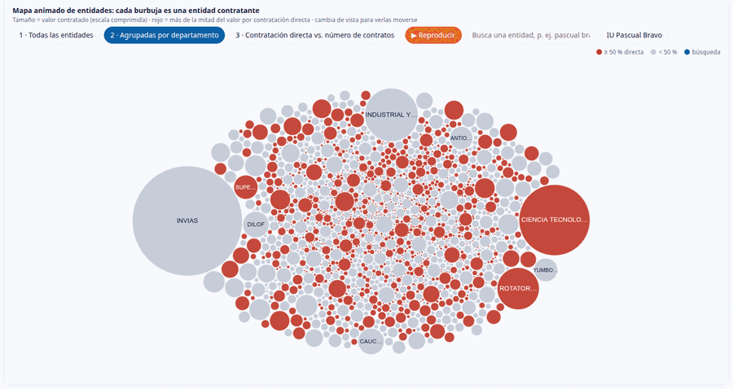
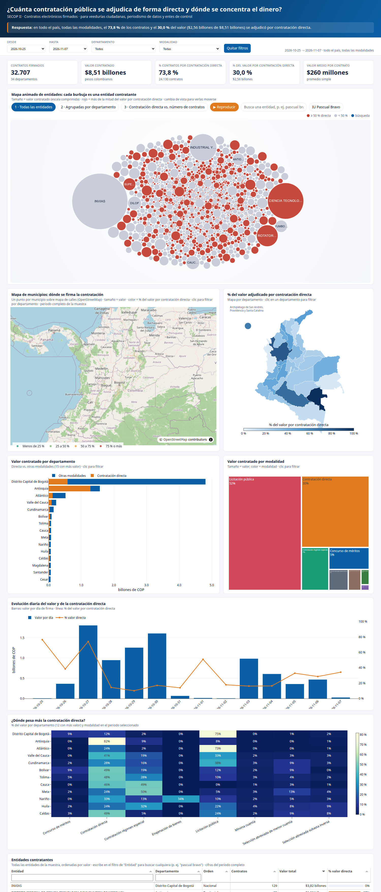
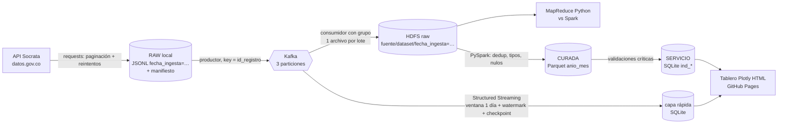

# Pipeline de datos SECOP II: de la fuente al tablero
Proyecto Pipeline de datos · Gestión de Datos Masivos G004 · Unidad 3 · I.U. Pascual Bravo

**Tablero publicado (GitHub Pages):** <https://mafe97.github.io/pipeline-secop-contratacion/> · **Notebook ejecutado:** [`pipeline_secop.ipynb`](pipeline_secop.ipynb) · **Presentación:** [`slides/Presentacion_Pipeline_SECOP_II.pdf`](slides/Presentacion_Pipeline_SECOP_II.pdf)





## 1. Fuente, pregunta y arquitectura (Fase 1)
| | |
|---|---|
| **Fuente** | datos.gov.co (Socrata) · *SECOP II – Contratos Electrónicos* · dataset `jbjy-vk9h` · <https://www.datos.gov.co/resource/jbjy-vk9h.json> |
| **Tamaño** | ~5,7 millones de registros en el dataset completo; la muestra de trabajo (contratos firmados del 25-oct al 7-nov-2026) tiene **32.707** contratos (≥ 20.000): 24.464 en la carga inicial + 8.243 en la carga incremental (así las cargó el notebook ejecutado; la corrida limpia final las trae en una sola pasada) |
| **Columna de fecha** | `fecha_de_firma` (también `ultima_actualizacion`); el dataset se actualiza a diario |
| **id_registro** | `id_contrato` (p. ej. `CO1.PCCNTR.7285347`): verificado único en la API (`count(*) = count(distinct id_contrato)`) |
| **Pregunta** | **¿Cuánta contratación pública se adjudica de forma directa y en qué departamentos, modalidades y entidades se concentra el dinero?** |
| **Usuarios** | veedurías ciudadanas, periodistas de datos y entes de control que priorizan dónde mirar |

> Cambiar de fuente solo exige tocar `pipeline/config.py` (dataset, `COL_ID`, `COL_FECHA`, `CAMPOS`) y la limpieza de `f5_curada.py`.

### Diagrama (raw → curada → servicio)

**Lambda, no Kappa.** Hay una capa *batch* (raw → curada → indicadores) que reconstruye todo de forma determinista y con limpieza completa, y una capa *rápida* (streaming) que da cifras por ventana apenas llegan los mensajes. El tablero las une: usa la vista batch y completa con la capa rápida los días que el batch aún no contiene. Kappa no aplica porque necesitamos reprocesar el historial completo cuando cambian las reglas de limpieza (el batch lo hace barato desde el raw).

## 2. Cómo ejecutarlo
Requisitos: Docker (Compose v2). Todo corre en contenedores (Kafka, HDFS, Python/PySpark).
```bash
cp .env.example .env              # el token de Socrata es opcional (déjalo en blanco)
docker compose up -d --build      # Kafka + NameNode + DataNode + contenedor de trabajo
docker compose exec pipeline python -m pipeline.run_pipeline      # pipeline completo; se detiene si algo falla
docker compose exec pipeline python -m dashboard.generar          # genera docs/index.html desde la zona de servicio
# abrir docs/index.html en el navegador
```
Paso a paso: `docker compose exec pipeline python -m pipeline.<módulo>`

| Fase | Módulo | Qué hace |
|---|---|---|
| 2 | `f2_ingesta` | API → sobres JSONL por `fecha_ingesta=…` + manifiesto + marca de agua |
| 3 | `f3_kafka_producer`, `f3_kafka_consumer` | publica a Kafka (key = id) y el consumidor escribe lotes en HDFS |
| 4 | `f4_mapreduce_vs_spark` | MapReduce (`pipeline/mapreduce/`) vs Spark sobre el raw de HDFS |
| 5 | `f5_curada` | limpieza con PySpark → Parquet particionado |
| 6 | `f6_calidad`, `demo_idempotencia` | validaciones + prueba de idempotencia (corre el pipeline dos veces) |
| 7 | `f7_streaming`, `demo_streaming` | Structured Streaming y prueba de reinicio |
| 8 | `f8_servicio`, `dashboard/generar.py` | indicadores en SQLite y tablero HTML |
| opc. | `airflow/dags/secop_pipeline_dag.py` | DAG diario con reintentos (ver Limitaciones) |

* **Notebook** (fases 2–8 con explicaciones y salidas): `tools/ejecutar_notebook.sh` lo construye y ejecuta dentro del contenedor.
* **Pruebas:** `docker compose exec pipeline pytest -q tests`.
* **Evidencias:** `bash run_evidencias.sh listados` (Kafka y `hdfs dfs -ls`) · `bash run_evidencias.sh hadoop` (MapReduce real vs Spark) · `bash run_evidencias.sh duplicados` (republica Kafka a propósito; reiniciar el stack después).
* **Presentación:** `AUTOR="Nombre" GRUPO="G004" python3 slides/build_slides.py` (requiere Chrome; genera el PDF con las cifras reales de la corrida).
* **Reinicio limpio:** `docker compose down -v` y borrar `data/raw data/state data/servicio data/calidad` y `data/checkpoints` (esta última pertenece a root: `docker compose exec pipeline rm -rf /app/data/checkpoints`).

## 3. Decisiones por fase
**Fase 2 – Ingesta.** `requests` con paginación (`$limit=10000`, `$offset`, orden estable por `fecha_de_firma,id_contrato`) y hasta 5 reintentos con espera exponencial ante 429/5xx/red. Cada registro va en un **sobre** con el original intacto en `payload`. JSONL en `fecha_ingesta=AAAA-MM-DD/` y un **manifiesto** por corrida (URL, parámetros, páginas, conteos, marca de agua antes/después) en `_manifiestos/`. Muestra en `muestras/`.

**Fase 3 – Kafka.** Tópico con 3 particiones; key = `id_registro` (un mismo contrato siempre cae en la misma partición); productor idempotente con `acks=all`; consumidor con grupo y commit manual **después** de escribir en HDFS (at-least-once).
*¿Qué pasa si el productor se ejecuta dos veces?* (1) un **ledger** de archivos ya publicados hace que la segunda corrida no publique nada; (2) si se fuerza (`--force`), el tópico sí duplica (32.707 → 65.414, ver `evidencias/kafka_duplicados.txt`) pero la zona curada deduplica por `id_registro` y el streaming usa `dropDuplicates`, así que curada, servicio y streaming siguen en 32.707. Kafka es un registro de eventos: se tolera el duplicado en tránsito y se elimina al curar.

**Fase 4 – HDFS y MapReduce.** Ruta `/datalake/raw/<fuente>/<dataset>/fecha_ingesta=…/lote_p<partición>_o<ini>-<fin>.jsonl`: **un archivo por lote de 5.000 mensajes** (no por mensaje), con nombre determinista alineado a offsets, de modo que reescribir un lote es idempotente. MapReduce (mapper/reducer Python, flujo `mapper | sort | reducer` de Hadoop Streaming leyendo de HDFS por WebHDFS) cuenta contratos y suma valor por departamento; Spark lo calcula igual y **coinciden en los 34 departamentos** (`evidencias/mapreduce_vs_spark.txt`). Se ejecuta de dos formas: (1) dentro de `run_pipeline`, como tubería `mapper | sort | reducer` sobre los datos leídos de HDFS; (2) como **job real de Hadoop Streaming** (`hadoop-streaming-3.2.1.jar`) en el contenedor del NameNode, que construimos con Python 3 (`Dockerfile.namenode`): `bash run_evidencias.sh hadoop` (32.707 registros de entrada → 34 de salida, `evidencias/hadoop_streaming_job.txt`), y su salida en HDFS (`/datalake/mapreduce_out`) también coincide con Spark (`evidencias/mapreduce_vs_spark_hadoop.txt`). El job usa el ejecutor local de MapReduce de Hadoop porque el stack no incluye YARN.

**Fase 5 – Zona curada.** Cada problema se mide y se guarda en `data/calidad/curada_stats.json` (copia en `muestras/`). Cifras de la corrida limpia final:
| Problema | Decisión | Por qué | Antes → después |
|---|---|---|---|
| Mismo `id_registro` repetido | una fila por id: mayor `fecha_ingesta`, luego mayor `ultima_actualizacion` | refleja el estado actual y no cuenta dos veces el dinero | 32.707 → 32.707 en la ingesta limpia; **65.414 → 32.707** al republicar Kafka a propósito (`evidencias/kafka_duplicados.txt`) |
| Fechas y números como texto | `timestamp` / `double`; lo inválido → NULL | necesarios para agregar; NULL es auditable | 0 nulos en la muestra |
| Nulos disfrazados (`No definido`, `Sin Descripcion`, vacío) | → NULL; `departamento` → `Sin dato` | no confundir "no definido" con un valor | 896 departamentos "No Definido" unificados |
| Modalidad escrita de varias formas (`Contratación directa` vs `Contratación Directa (con ofertas)`, tildes, etc.) | catálogo de 8 grupos + `es_directa` | si no, la contratación directa se subestima | 13 modalidades → 8 |
| Valor nulo / negativo / > 1e13 o sin fecha de firma | se descartan y se cuentan por razón | distorsionan sumas; el raw conserva todo | 0 descartes en esta muestra |

*Honestidad:* en esta ventana la fuente no traía nulos de fecha/valor ni valores absurdos, así que las reglas de descarte no se activaron; están medidas y listas. La de duplicados sí se activó con la republicación forzada.
**Partición:** `anio_mes` (2 particiones en la muestra). Las consultas son temporales; el mes da pocas particiones grandes (el día generaría archivos diminutos) y crece de forma predecible; `departamento` (34 valores muy sesgados a Bogotá/Valle/Antioquia) daría particiones desiguales. **Tamaño:** JSONL raw ≈ 145 MB → Parquet 2,2 MB (−98,5 %); el Parquet guarda solo las ~25 columnas que se usan (el JSONL conserva las ~100 del original) además de la compresión columnar.

**Fase 6 – Calidad, incremental, idempotencia.** `f6_calidad` corre 5 validaciones (4 críticas: conteo > 0, sin nulos en id/fecha/valor, sin `id_registro` repetidos, valor en [0, 1e13]; 1 de advertencia: descartados < 5 %) y guarda `reporte_calidad.json` con las filas descartadas. Si una crítica falla → `exit 1` y `run_pipeline` se detiene. **Marca de agua**: última `fecha_de_firma` cargada (`data/state/watermark.json`) + ids en esa marca exacta para no repetir el borde; la ventana `[INGEST_DESDE, INGEST_HASTA)` es fija para que sea reproducible. Evidencia: ampliar `INGEST_HASTA` trajo solo 8.243 contratos nuevos (omitió 1 del borde) y repetir la misma ventana escribió 0 (`evidencias/incremental_marca_de_agua.txt`). **Idempotencia**: `demo_idempotencia` corre el pipeline dos veces y compara 8 conteos (raw, Kafka, HDFS, curada, batch, streaming): todos iguales (`evidencias/idempotencia.txt`). La curada se *reconstruye* desde el raw con `overwrite` de particiones y el servicio usa `replace`, por eso repetir no duplica.

**Fase 7 – Streaming (Lambda).** Structured Streaming lee el tópico, agrega por **ventana de 1 día** (event time `fecha_de_firma`) con **watermark de 7 días** y **checkpoint** (`data/checkpoints/stream`); salida por `foreachBatch` con *upsert* en SQLite (clave = ventana). Al reiniciar, el checkpoint evita releer offsets: segunda corrida 0 filas de entrada y mismas 14 ventanas / 32.707 contratos (`evidencias/streaming_reinicio.txt`). Usa `Trigger.availableNow` (procesa lo pendiente y termina) para poder orquestarlo y demostrar reinicios. Los totales de la capa rápida coinciden con los de la batch.

**Fase 8 – Servicio y tablero.** SQLite con indicadores listos (`ind_directa_por_departamento`, `ind_modalidad`, `ind_top_entidades`, `ind_serie_diaria`, más `ind_cubo_dia_dep_modalidad`, `ind_entidades`, `ind_municipios` y `meta_corte`). **Tablero: Plotly HTML** (una de las herramientas permitidas en el enunciado), estático y publicado en GitHub Pages; lo genera `dashboard/generar.py` leyendo solo la zona de servicio. Incluye título que responde la pregunta, respuesta dinámica, 5 KPIs, **burbujas animadas con D3** (cada burbuja es una entidad; botones y ▶ Reproducir las mueven entre tres vistas: nube por valor, agrupadas por departamento y dispersión % directa vs. número de contratos; con buscador que resalta una entidad, p. ej. `…/#q=pascual bravo&vista=disp`), **mapa de municipios sobre mapa de calles OpenStreetMap** (un punto por municipio, tamaño = valor y color = % directa; las coordenadas salen de un segundo conjunto abierto, DIVIPOLA `gdxc-w37w` de datos.gov.co, que ubica 593 de 597 municipios y el 99,99 % del valor), **mapa coroplético** (límites DANE; San Andrés como marcador en un recuadro), barras apiladas, treemap, serie diaria con eje secundario, **mapa de calor** departamento × modalidad y **tabla Tabulator** con **todas las entidades** (2.092 en la muestra), ordenable y con buscador (p. ej. `…/#ent=pascual bravo` muestra a IU Pascual Bravo: 91 contratos, $959 millones, 94 % por contratación directa); filtros por fechas, departamento y modalidad (clic en mapa/barras/treemap filtra); pie con **fuente y fecha de corte**. Las librerías (Plotly.js, D3 y Tabulator) van incluidas en `docs/vendor/`, así que el tablero abre **sin internet**, salvo el mapa base de calles (las teselas de OpenStreetMap se descargan en línea). El diseño de las burbujas animadas toma como referencia un gráfico de Flourish y el mapa de puntos un tablero de Tableau Public (TianguisCDMX); ver la sección 6. Resultado: 32.707 contratos, $8,51 billones COP, 73,8 % de los contratos y 30,0 % del valor por contratación directa; 3 departamentos concentran el 81 % del valor.

## 4. Estructura y evidencias
```
pipeline/    config, common, f2…f8, mapreduce/, demos, conteos, run_pipeline
dashboard/   generar.py + plantilla.html + assets/ (geojson, DIVIPOLA) + vendor/ (JS/CSS)      docs/   tablero publicado
pipeline_secop.ipynb   notebook ejecutado (fases 2–8)              slides/   presentación (PDF, 8 diapositivas)
airflow/dags/   DAG opcional      tests/   pytest      tools/   notebook y job de Hadoop Streaming
Dockerfile.namenode   NameNode de Hadoop + Python 3
muestras/    raw (200 líneas), manifiestos, reporte de calidad y tablas de servicio (CSV)
evidencias/  salidas de Kafka, HDFS, MapReduce vs Spark, idempotencia, streaming, incremental, calidad y capturas del tablero
```
Capturas: `evidencias/burbujas_animacion.gif` (animación de las burbujas), `evidencias/burbujas_busqueda_pascual_bravo.png`, `evidencias/tablero_mapa_municipios.png`, `evidencias/tablero_completo.png` (local), `evidencias/tablero_publicado_github_pages.png` (la página desplegada), `evidencias/tablero_filtrado_antioquia.png` (filtro por departamento; los filtros también se pueden compartir por URL, p. ej. `…/#dep=Antioquia&mod=Contratación directa`) y `evidencias/tablero_busqueda_pascual_bravo.png` (búsqueda de una entidad en la tabla) y `evidencias/hdfs_namenode_explorer.png` (explorador de HDFS con los lotes del raw).

## 5. Limitaciones
- **Opcionales no hechos:** Hive no se implementó, y el DAG de Airflow (`airflow/dags/`) está escrito pero no se desplegó ni probó en un Airflow real.
- **Sin YARN:** el job de Hadoop Streaming usa el ejecutor local de MapReduce de Hadoop. Kafka y HDFS también son de un solo nodo (replicación 1 en Kafka).
- **Mapa base en línea:** el mapa de municipios necesita internet para las teselas de OpenStreetMap; el resto del tablero funciona sin conexión.
- **Reglas de descarte sin casos reales:** en esta muestra la fuente no traía nulos de fecha/valor ni valores absurdos, así que esos descartes dan 0 (están medidos y listos).

## 6. Fuentes y referencias
**Datos**
- SECOP II – Contratos Electrónicos, Agencia Nacional de Contratación Pública (Colombia Compra Eficiente), en datos.gov.co: <https://www.datos.gov.co/Gastos-Gubernamentales/SECOP-II-Contratos-Electr-nicos/jbjy-vk9h> · API: <https://www.datos.gov.co/resource/jbjy-vk9h.json>
- DIVIPOLA – Códigos y coordenadas de municipios (DANE), en datos.gov.co: <https://www.datos.gov.co/Mapas-Nacionales/DIVIPOLA-C-digos-municipios/gdxc-w37w>
- Límites departamentales (DANE, MGN 2018) en GeoJSON, repositorio `caticoa3/colombia_mapa`: <https://github.com/caticoa3/colombia_mapa>
- Mapa base de calles © colaboradores de OpenStreetMap: <https://www.openstreetmap.org/copyright>

**Proyecto de ejemplo del curso**
- Indicadores económicos de Colombia (A. E. Pineda Ramírez): <https://github.com/aleixopirez/indicadores-colombia> · <https://aleixopirez.github.io/indicadores-colombia/>

**Documentación técnica**
- API Socrata (SoQL): [consultas](https://dev.socrata.com/docs/queries/), [`$limit`](https://dev.socrata.com/docs/queries/limit.html), [`$offset`](https://dev.socrata.com/docs/queries/offset.html), [app tokens](https://dev.socrata.com/docs/app-tokens.html) · [`requests`](https://docs.python-requests.org/en/latest/)
- Apache Kafka: [documentación](https://kafka.apache.org/documentation/) · [cliente `confluent-kafka`](https://docs.confluent.io/platform/current/clients/confluent-kafka-python/html/index.html) · [imagen Docker `apache/kafka`](https://hub.docker.com/r/apache/kafka)
- Hadoop 3.2.1: [Hadoop Streaming](https://hadoop.apache.org/docs/r3.2.1/hadoop-streaming/HadoopStreaming.html) · [comandos `hdfs dfs`](https://hadoop.apache.org/docs/r3.2.1/hadoop-project-dist/hadoop-common/FileSystemShell.html) · [cliente WebHDFS `hdfs`](https://hdfscli.readthedocs.io/) · [imagen Docker `bde2020/hadoop-namenode`](https://hub.docker.com/r/bde2020/hadoop-namenode)
- Apache Spark (el proyecto usa 3.5.3; enlaces a la versión actual de la documentación): [Structured Streaming](https://spark.apache.org/docs/latest/structured-streaming-programming-guide.html) · [integración con Kafka](https://spark.apache.org/docs/latest/structured-streaming-kafka-integration.html) · [Parquet en Spark](https://spark.apache.org/docs/latest/sql-data-sources-parquet.html)
- Apache Parquet: <https://parquet.apache.org/docs/overview/>
- Arquitectura: [Lambda (Databricks)](https://www.databricks.com/glossary/lambda-architecture) · [Data lake (Martin Fowler)](https://martinfowler.com/bliki/DataLake.html)
- Tablero: [Plotly.js](https://plotly.com/javascript/) · [D3](https://d3js.org/) · [Tabulator](https://tabulator.info/)

**Referencias de diseño del tablero**
- Burbujas animadas: gráfico de Flourish usado como referencia: <https://public.flourish.studio/uploads/1812907/856f31f1-23ef-4ee5-a7bb-55303f2791fe.gif>
- Mapa de puntos sobre mapa de calles: "Tianguis CDMX" (Jorge González), Tableau Public: <https://public.tableau.com/app/profile/jorge.gonzalez2573/viz/TianguisCDMX/Dashboard1>
- Ideas de conjuntos de datos públicos: Tableau, "Free public data sets": <https://www.tableau.com/learn/articles/free-public-data-sets>
